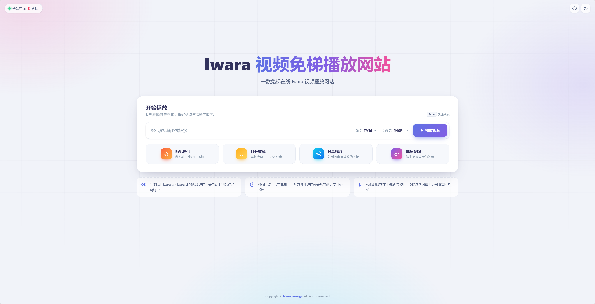

<h1 align="center">Iwara Video Proxy</h1>

<p align="center">
  
</p>

<p align="center">
  <strong>简单反代 Iwara · 绕过限制，自由播放！</strong>
</p>

<p align="center">
  一个支持 <strong>Cloudflare Worker、Node.js 与 Python 私有部署</strong> 的 Iwara 视频播放与双站整站反代解决方案。
</p>

<p align="center">
  
  
  
  
  
</p>


> [!IMPORTANT]
> **Iwara 已新增 [AI 视频网站](https://www.iwara.ai)**。本项目已跟随更新，目前支持播放 **[www.iwara.tv](https://www.iwara.tv)** 与 **[www.iwara.ai](https://www.iwara.ai)** 两个站点的视频。
>
> **新增 [“Iwara双站(TV和AI)”](./反代Iwara双站/) 整个网站反代方案**：提供 **Node.js 与 Cloudflare Worker** 两种实现，覆盖两个站点的原站首页、账号登录、视频浏览 / 搜索 / 播放、图片、论坛发帖与评论等功能。使用原站界面操作，部署方法见下方 [双站整站反代](#dual-site)。

---

## 📖 目录

<p align="center">
  <a href="#demo">🌐 演示站点</a> ·
  <a href="#features">✨ 功能亮点</a> ·
  <a href="#preview">📸 界面预览</a> ·
  <a href="#files">📂 文件说明</a> ·
  <a href="#stack">🛠️ 技术栈</a> ·
  <a href="#auth">🔐 认证与 Token</a> ·
  <a href="#security">🛡️ 核心安全</a> ·
  <a href="#deploy">🚀 部署指南</a> ·
  <a href="#dual-site">🪞 双站整站反代</a> ·
  <a href="#tips">💡 使用小贴士</a> ·
  <a href="#thanks">🙏 鸣谢</a>
</p>

---

<a id="demo"></a>

## 🌐 演示站点

想要立即体验？可直接访问以下由 **Cloudflare Worker** 驱动的演示站点：<a href="https://ss.ixq.pp.ua"><strong>🚀 主演示站</strong></a> · <a href="https://ss.iys.pp.ua"><strong>🛰️ 备用演示站</strong></a>

整站反代方案可按 [双站整站反代部署说明](#dual-site) 自行部署。下面是反代双站演示站点：<a href="https://tv.iww.de5.net"><strong>🚀 反代TV演示站</strong></a>  · <a href="https://ai.iww.de5.net"><strong>🛰️ 反代AI演示站</strong></a>

---

<a id="preview"></a>

## 📸 界面预览

<p align="center">
  
</p>

---

<a id="features"></a>

## ✨ 功能亮点

- 🌍 **双站点支持**：兼容 `www.iwara.tv` 与 `www.iwara.ai` 视频播放。
- 🪞 **双站整站反代**：新增 `反代Iwara双站/`，保留原站界面与操作流程，支持账号登录、视频浏览 / 搜索 / 播放、图片、论坛浏览 / 发帖 / 评论等功能。
- 🔀 **双站入口配置**：Node.js 版可用两个端口运行主站与 AI 站；Worker 版支持单 Worker + 两个代理域名，也可分别部署两个 Worker，并自动处理 `X-Site` 与共享后端域名。
- 🚫 **整站广告拦截**：新方案默认拦截广告 / 追踪域名并隐藏广告容器，可通过 `NO_AD_BLOCK=1` 关闭；视频与图片保留流式转发及 Range / `206` 支持。
- ⚡ **多种部署方式**：支持 Cloudflare Worker、Node.js 与 Python 私有部署。
- 🔐 **前后端 Token 机制**：支持前端自定义 Token 与后端默认 Token，并按优先级自动选择。
- 🛡️ **全局访问保护**：可通过 Basic Auth 为站点及相关接口增加统一认证。
- 🔍 **Token 状态监控**：后端提供 `/token-status`，用于检测默认 Token 的配置与有效状态。
- 🔄 **Iwara 自动登录**：默认 Token 缺失、过期或被拒绝时，可由后端安全刷新共享 Token。
- 📢 **远程通知**：可从 JSON 接口读取站点通知，支持每日一次、仅一次和用户关闭提示。
- 📊 **额度保护**：可查询 Cloudflare Analytics，在每日请求量接近上限时让新会话自动改用视频直连。
- 🚧 **播放接口安全校验**：`/view` 对域名、路径、查询参数和请求方法实施严格限制。
- 👥 **实时会话数**：Cloudflare Worker 可通过 Durable Objects + WebSocket 开启在线会话统计，Node.js 与 Python 版内置 WebSocket 统计；前端在用户交互或等待 8 秒后延迟连接。
- 🧩 **可选挑战处理**：Node.js 与 Python 私有部署均支持 FlareSolverr，可在上游返回 Cloudflare 挑战时尝试解盾并重试。
- 📋 **剪切板链接识别**：在获得浏览器权限后，可自动识别剪切板中的 Iwara 视频链接并提示。

| 使用需求 | 对应方案 |
| :-- | :-- |
| **粘贴链接播放视频** | `Worker部署/`、`完全私有部署/`：使用本项目播放界面，提供自定义 Token、共享账号、通知与在线人数等功能 |
| **通过原站界面使用双站功能** | `反代Iwara双站/`：代理原站页面、API、图片与视频，使用自己的 Iwara 账号登录、搜索视频、发帖和评论 |

---

<a id="files"></a>

## 📂 项目主要文件说明

| 文件 / 目录 | 用途 |
| :-- | :-- |
| `Worker部署/worker.js` | **Worker 核心**：包含后端业务逻辑与完整 HTML / CSS / JavaScript 前端，无需复杂构建流程 |
| `sweetalert.min.js` | **UI 组件**：提供更友好的前端弹窗交互 |
| `Worker部署/` | **Cloudflare Worker 统一版**：可选开启全站实时会话数，无需维护两份 Worker 代码 |
| `完全私有部署/Nodejs环境/` | **Node.js 私有部署**：`server.mjs` 适配运行时，`worker.mjs` 包含业务逻辑与前端，附有配置示例和部署说明 |
| `完全私有部署/Python环境/` | **Python 私有部署**：`server.py` 启动服务，`worker.py` 实现业务逻辑，`index.html` 提供完整前端，附有配置示例、部署说明与本地测试 |
| `反代Iwara双站/Nodejs版.zip` | **双站整站反代 · Node.js**：包含 `proxy.js`、`package.json`、`test.js` 与独立 README；零 npm 依赖，默认使用系统 `curl` 回源 |
| `反代Iwara双站/Worker版.zip` | **双站整站反代 · Worker**：解压后为 `Iwara-Worker-Dual/`，包含 `worker.js`、`wrangler.toml`、测试与独立 README；支持双域名入口映射 |
| `浏览器脚本/` | **浏览器用户脚本**：提供 Iwara 视频反代加速脚本 |

---

<a id="stack"></a>

## 🛠️ 技术栈

| 模块 | 使用技术 |
| :-- | :-- |
| **前端** | HTML5、CSS3（Modern UI）、JavaScript（ES6+）、SweetAlert |
| **Worker 版** | Cloudflare Workers（V8 Runtime）、Fetch API |
| **Node.js 版** | Node.js HTTP 服务、原生 Fetch API、`ws`，可选 `impit` 指纹回放 |
| **Python 版** | `aiohttp` 异步 HTTP / WebSocket 服务，可选 `curl_cffi` 指纹回放 |
| **私有部署挑战处理** | 可选 FlareSolverr，支持 clearance 缓存、重试与浏览器内容直取 |
| **整站反代 · Node.js** | Node.js 内置 HTTP / HTTPS 模块、系统 `curl`、页面与 API URL 重写、浏览器运行时补丁，无需安装 npm 依赖 |
| **整站反代 · Worker** | Cloudflare Workers 原生 Fetch API、流式转发、`SITE_HOST_MAP` 双域名映射与浏览器运行时补丁 |

---

<a id="auth"></a>

## 🔐 认证与 Token 机制

为了防止站点滥用，并避免与 Iwara 原生请求头产生冲突，项目提供了前后端协同的认证与 Token 处理机制。

> [!NOTE]
> 本节的 `CustomizedToken`、Basic Auth 与后端共享 Token 配置适用于 `Worker部署/`、`完全私有部署/` 的视频播放站。新增 `反代Iwara双站/` 使用**原站账号登录流程**，转发登录请求、Cookie 与原站 `Authorization`；账号由用户在代理后的原站登录页面填写。

### 🔑 自定义 Token：`CustomizedToken`

| 环节 | 处理方式 |
| :-- | :-- |
| **前端** | 不直接发送 `Authorization`，而是发送 `CustomizedToken: Bearer xxxxx` |
| **后端** | 自动读取 `CustomizedToken`，转发请求时映射回 Iwara 要求的标准 `Authorization` 请求头 |
| **目的** | 避免与 Basic Auth 使用的 `Authorization` 请求头发生冲突 |

### 🛡️ 后端 Basic Auth（全局保护）

通过环境变量 `BASIC_AUTH_USER` 与 `BASIC_AUTH_PASS` 启用。

- **作用范围**：全局生效，可保护首页、`/video*`、`/file*`、`/view`、状态接口与在线人数 WebSocket。
- **默认行为**：两个变量留空时不启用 Basic Auth，无需密码即可访问。

### 🤖 智能 Token 处理

- **后端默认 Token**：可通过 `IWARA_AUTHORIZATION` 设置站点级默认 Token。
- **后端自动登录**：Worker、Node.js 与 Python 版均支持；同时配置 `IWARA_USERNAME` 与 `IWARA_PASSWORD` 后，默认 Token 缺失或即将过期时会通过 Iwara 官方登录接口自动获取新 Token。
- **自动刷新**：上游明确返回 `401` 时，后端会重新登录并只重试原请求一次；并发登录会自动合并，失败后冷却 60 秒。前端自定义 Token 不触发后端续期。
- **内存缓存**：自动获取的 Token 只缓存在当前 Worker 实例或私有服务进程内，不写入浏览器、日志或项目文件；新实例或进程重启后会按需重新登录。
- **自动标准化**：系统会自动处理 JWT；无论是否包含 `Bearer ` 前缀，都会标准化为正确格式。

### 🚦 Token 优先级

优先级由高到低：

1. **前端 Token**：用户在页面中自行填写的 `CustomizedToken`。
2. **有效的后端默认 Token**：环境变量 `IWARA_AUTHORIZATION`；Worker / Node.js 版也支持代码中的默认值 `DEFAULT_IWARA_AUTHORIZATION`。
3. **后端自动登录 Token**：默认 Token 缺失、过期或被上游拒绝时，通过 `IWARA_USERNAME` 与 `IWARA_PASSWORD` 获取。

> [!NOTE]
> 当前端已经提供 `CustomizedToken` 时，将优先使用用户自己的 Token，而不是后端默认 Token。

---

<a id="security"></a>

## 🛡️ 核心功能与安全

本节介绍视频播放站的状态接口、通知与 `/view` 校验。整站反代采用 `/p/<host>/...` 路由和目标域名白名单，并转发登录、发帖、评论所需的请求方法与请求体；相关配置见 [双站整站反代](#dual-site)。

### 🔍 Token 状态监控：`/token-status`

后端提供 `/token-status` 接口，用于实时检测后端默认 Token 的状态：

| 状态 | 返回结果 |
| :-- | :-- |
| **未配置 Token** | `204 No Content`，并附带 1 天节流头 |
| **Token 有效** | `204 No Content` |
| **Token 已过期** | 返回 `{"code": "backend_token_expired", ...}`，前端据此引导用户处理 |
| **自动登录配置不完整** | 返回 `{"code": "backend_login_misconfigured", ...}` |
| **登录凭据被拒绝** | 返回 `backend_login_credentials_rejected`，前端明确提示检查登录邮箱和密码 |
| **接口响应缺少 Token** | 返回 `backend_login_invalid_response`，前端提示管理员检查接口变化 |
| **限流或上游暂时异常** | 返回 `backend_login_rate_limited`、`backend_login_upstream_blocked` 或 `backend_login_temporarily_unavailable`，进入约 60 秒冷却但不弹出误导性的配置错误提示 |

#### 自动登录排查

部署最新版后，请先确认变量确实绑定在**当前 Worker 与当前环境**：

```bash
cd Worker部署
npx wrangler secret list
```

列表中应同时出现 `IWARA_USERNAME` 和 `IWARA_PASSWORD`。如果使用 Wrangler 的命名环境，请在查看、设置 Secret 和部署时都带上相同的 `--env 环境名`。`IWARA_USERNAME` 会作为登录 JSON 的 `email` 字段发送，优先填写 Iwara 登录邮箱。

Node.js / Python 私有部署请检查对应目录的 `.env` 或启动进程的环境变量，两项凭据必须同时配置，修改后需重启服务；系统环境变量优先于 `.env`。下方诊断接口同样适用于私有部署。

然后请求脱敏诊断接口。该请求本身会在需要时触发一次自动登录：

```bash
curl.exe -i "https://你的域名/token-status"
curl.exe -sS "https://你的域名/token-status?debug=1"
```

`?debug=1` 只返回变量是否存在、请求时间、HTTP 状态、响应类型、缓存状态和脱敏错误，不返回用户名、密码、Token 或上游响应正文。重点查看：

| 字段 | 如何判断 |
| :-- | :-- |
| `configured.username/password` | 两项都应为 `true`，否则当前部署环境没有完整读取自动登录凭据 |
| `autoLogin.attempted` | 为 `true` 表示已发起登录；已有有效 `IWARA_AUTHORIZATION` 时不会提前登录 |
| `lastResponseStatus` | `200` 通常表示接口接受请求；`400/401` 多为账号或接口参数问题；`403` 可能是上游风控拦截 |
| `lastResponseContentType` | 正常接口通常为 JSON；`403` 且为 `text/html` 通常表示返回了挑战页而不是登录 JSON |
| `authorizationSource` | `auto_login_cache` 表示自动登录 Token 已获取并在当前实例或进程缓存 |
| `cachedTokenAvailable` | 为 `true` 表示响应内找到了可用 Token |
| `failureReason` | 区分 `rate_limited`、`credentials_rejected`、`upstream_blocked`、`upstream_unavailable`、`network_error` 和 `invalid_response` |
| `retryAfterSeconds` | 失败后的剩余冷却秒数；最多约 60 秒 |

浏览器只会针对能够明确判断的配置问题、凭据被拒绝或登录响应缺少 Token 弹窗。`429` 限流、`403` 上游拦截、网络错误和上游 `5xx` 会静默等待后续请求自动恢复，避免出现“受限视频可以观看，但首页仍提示配置错误”的误报。

同时可在另一个终端实时查看 Worker 的脱敏日志：

```bash
cd Worker部署
npx wrangler tail --format pretty
```

触发 `/token-status?debug=1` 后，应依次看到 `request_started`、`response_received`，成功时再看到 `login_succeeded`，失败时则是 `login_failed`。日志刻意不记录请求体、密码、Token 和响应正文。如果启用了站点 Basic Auth，请先在浏览器登录，或在调试请求中提供对应的 Basic Auth；不要把 Iwara 密码当作站点 Basic Auth 密码。

私有部署可直接查看 Node.js / Python 服务的终端或进程管理器日志；Python 版以登录成功、失败原因与冷却时间记录结果。

### 📊 Worker 请求额度保护

Worker 可以使用 [Cloudflare GraphQL Analytics](https://developers.cloudflare.com/analytics/graphql-api/tutorials/querying-workers-metrics/) 查询当天请求量。根据 [Cloudflare Workers 官方限制](https://developers.cloudflare.com/workers/platform/limits/)，免费计划默认按每天 `100000` 次计算；剩余额度小于等于阈值时，**新打开的页面**会把视频播放地址切换为直连，视频信息与下载仍经过 Worker。

| 变量 | 用途 | 默认值 |
| :-- | :-- | :-- |
| `CF_ACCOUNT_TAG` | Cloudflare 账户 ID | 空 |
| `CF_ANALYTICS_API_TOKEN` | 具有 Analytics 读取权限的 API Token，必须使用 Secret | 空 |
| `CF_WORKER_SCRIPT_NAME` | 当前 Worker 脚本名称 | 空 |
| `WORKERS_DAILY_REQUEST_LIMIT` | 每日请求额度 | `100000` |
| `DIRECT_MODE_REMAINING_REQUESTS_THRESHOLD` | 进入直连模式的剩余请求数阈值 | `100` |
| `PLAYBACK_MODE_CACHE_TTL_SECONDS` | 请求量判断缓存时间 | `300` |
| `FORCE_PLAYBACK_MODE` | 手动指定 `proxy` 或 `direct`；留空时自动判断 | 空 |
| `NEW_SITE_URL` | 进入直连模式时提供的备用站点 | 空 |

未配置 Analytics 三项必要参数时会保持代理模式。可访问 `/playback-mode-debug` 查看判断结果；只有启用 Basic Auth 后，`?refresh=1` 才会绕过缓存重新查询，避免公开接口被滥用。

### 📢 远程通知

设置 `NOTICE_API_URL` 后，后端会读取并缓存通知 JSON，Worker、Node.js 与 Python 版均支持。通知正文支持经过安全过滤的常用 HTML；同一通知默认每天最多出现一次，用户也可以选择“不再提示”。

```json
{
  "hasNotice": true,
  "noticeId": "maintenance-2026-09",
  "title": "维护通知",
  "content": "<h3>维护通知</h3><p>今晚 23:00 进行短暂维护。<br><a href=\"https://example.com/status\" target=\"_blank\">查看状态</a></p>",
  "showOnce": false
}
```

支持的常用标签包括 `h1`–`h6`、`p`、`br`、`a`、`img`、粗体/斜体、列表、引用、代码块、折叠内容和表格等。链接仅允许 HTTP(S)、邮箱、电话或站内相对地址；图片仅允许 HTTP(S) 或站内相对地址。`script`、`style`、`iframe`、表单、内联事件（如 `onclick`）、危险 URL 和未列入白名单的属性会被删除。

可通过 `NOTICE_API_CACHE_TTL_SECONDS` 调整缓存时间，默认 `300` 秒。`showOnce: true` 表示该浏览器仅显示一次；更换 `noticeId` 可以发布一条新通知。

### 🚧 `/view` 严格安全规则

为减少后端 Token 被非法滥用的风险，播放链接需要通过以下校验：

- **域名锁定**：必须匹配 `xxx.iwara.tv`。
- **路径校验**：路径必须严格为 `/view`。
- **参数校验**：必须包含一个及以上查询字符串。
- **方法限制**：仅允许 `GET` 与 `OPTIONS`，其余请求方法统一返回 `403`。

---

<a id="deploy"></a>

## 🚀 部署指南

**视频播放站**可选择下方 A / B / C；需要通过原站界面登录、搜索、发帖等功能时，请使用 [D. 双站整站反代](#dual-site)。

### 🌟 A. Cloudflare Worker（推荐）

Worker 已合并为一份统一代码，会根据是否绑定 `ONLINE_COUNTER` 自动切换运行模式：

| 模式 | Durable Object | 实时用户会话数 | WebSocket |
| :-- | :--: | :--: | :--: |
| **无会话模式（默认）** | ❌ | ❌ | ❌ |
| **有会话模式** | ✅ `ONLINE_COUNTER` | ✅ | ✅ |

#### ☁️ 一键部署（默认无会话）

<p align="center">
  <a href="https://deploy.workers.cloudflare.com/?url=https://github.com/Iskongkongyo/iwaraVideoProxy/tree/main/Worker%E9%83%A8%E7%BD%B2">
    
  </a>
</p>

部署时登录 Cloudflare，按页面提示选择账号、修改 Worker 名称并完成部署即可。

Cloudflare 会从 `Worker部署` 子目录读取：

- `wrangler.toml`
- `worker.js`

默认配置**不会创建 Durable Object**。

> [!TIP]
> 一键部署完成后，可在 Cloudflare 控制台的 `设置 → 变量和机密` 中按需添加 `BASIC_AUTH_USER`、`BASIC_AUTH_PASS` 与 `IWARA_AUTHORIZATION`。自动登录使用的 `IWARA_USERNAME`、`IWARA_PASSWORD` 必须保存为**机密**。
>
> 如需开启实时会话数，请在新建的 Git 仓库中取消 `wrangler.toml` 对应配置的注释，然后重新部署。

#### 🧩 无会话模式：面板部署

1. 复制 `Worker部署/worker.js` 的完整内容。
2. 打开 [Cloudflare 控制台](https://dash.cloudflare.com/login)，创建新的 Worker，粘贴代码并部署；此模式无需设置 Durable Object。
3. 配置环境变量。支持以下两种方式：

**方式一：直接修改 `worker.js` 默认值**

```js
const DEFAULT_BASIC_AUTH_USER = ''; // 设置访问用户名
const DEFAULT_BASIC_AUTH_PASS = ''; // 设置访问密码
const DEFAULT_IWARA_AUTHORIZATION = ''; // 设置默认使用的 Iwara 账号 Token
const DEFAULT_NOTICE_API_URL = ''; // 设置通知接口 URL
const DEFAULT_NEW_SITE_URL = ''; // 设置直连模式提示的备用站点
```

**方式二：使用 Worker 环境变量（更推荐）**

在 Worker 面板中添加：

```text
BASIC_AUTH_USER
BASIC_AUTH_PASS
IWARA_AUTHORIZATION
NOTICE_API_URL
```

如需自动登录，请另外添加以下两个变量，并将类型设置为**机密**：

```text
IWARA_USERNAME
IWARA_PASSWORD
```

`IWARA_USERNAME` 会作为登录接口 JSON 中的 `email` 字段提交，建议填写 Iwara 登录邮箱。若配置后没有生效，请参考上方“自动登录排查”。

请求额度自动保护还需要配置 `CF_ACCOUNT_TAG`、`CF_WORKER_SCRIPT_NAME`，并将 `CF_ANALYTICS_API_TOKEN` 保存为机密。其余阈值、缓存和备用站点变量可参考上方“Worker 请求额度保护”表格。

配置路径：

```text
构建 → Compute → Workers 和 Pages → 设置 → 变量和机密
```

填写需要的环境变量后重新部署即可。

> [!WARNING]
> 建议为 Worker 绑定自定义域名，因为 `*.workers.dev` 在国内部分网络环境中可能受限。

#### 👥 有会话模式：Wrangler 部署

1. 安装 [Node.js](https://nodejs.org/zh-cn/download) **20 或更高版本**，然后进入 `Worker部署` 目录。
2. 打开 `wrangler.toml`，修改 `name`。
3. 取消 `durable_objects.bindings` 与 `migrations` 两段配置的注释。
4. 两段配置必须**同时启用**，绑定名称保持为 `ONLINE_COUNTER`。

> [!NOTE]
> 实时会话数使用 **Cloudflare Durable Objects** 与**休眠 WebSocket**。实际额度及用量请以 Cloudflare 控制台和[官方配置文档](https://developers.cloudflare.com/workers/wrangler/configuration/#durable-objects)为准。

安装 Wrangler：

```bash
npm install -D wrangler@latest
```

登录并部署：

```bash
npx wrangler login
npx wrangler deploy
```

自动登录凭据建议通过 Wrangler Secret 设置，不要写入 `wrangler.toml`：

```bash
npx wrangler secret put IWARA_USERNAME
npx wrangler secret put IWARA_PASSWORD
npx wrangler secret put CF_ANALYTICS_API_TOKEN
```

登录命令会打开浏览器完成授权。

如之后希望关闭实时会话数，只需重新注释 `wrangler.toml` 中上述两段配置并再次部署，**无需更换 `worker.js`**。

### 📦 B. Node.js 环境（完全私有部署）

需要 **Node.js 18 或更高版本**（建议 20+），进入对应目录后安装依赖：

```bash
cd "完全私有部署/Nodejs环境"
npm install
```

将 `.env.example` 复制为 `.env`，按注释填写配置后启动：

```bash
npm start
```

默认监听 `0.0.0.0:3000`，可通过 `HOST`、`PORT` 修改。服务直接请求 Iwara 上游，内置 Basic Auth、Token 自动登录续期、视频 Range 流式代理与在线人数 WebSocket。

详细说明见 [Node.js 部署文档](./完全私有部署/Nodejs环境/README.md)。

### 🐍 C. Python 环境（完全私有部署）

需要 **Python 3.10 或更高版本**，可独立运行，无需安装 Node.js。进入对应目录并创建虚拟环境：

```bash
cd "完全私有部署/Python环境"
python -m venv .venv
```

激活虚拟环境：Windows PowerShell 使用 `.\.venv\Scripts\Activate.ps1`；Linux / macOS 使用 `source .venv/bin/activate`。随后安装依赖：

```bash
python -m pip install -r requirements.txt
```

将 `.env.example` 复制为 `.env`，按注释填写配置后启动：

```bash
python server.py
```

默认监听 `0.0.0.0:3000`，可通过 `HOST`、`PORT` 修改。前端与 Node.js 版一致，支持相同的代理、认证、自动登录、通知与在线人数功能。

可在本目录执行 `python -m unittest discover -s tests -v`，使用本地模拟上游验证，无需真实 Iwara 账号。

详细说明见 [Python 部署文档](./完全私有部署/Python环境/README.md)。

### ⚙️ Node.js / Python 可选环境变量

以下配置可写入各自目录的 `.env`，也可通过系统环境变量设置；系统环境变量优先，修改后需重启服务：

```dotenv
HOST=0.0.0.0
PORT=3000
BASIC_AUTH_USER=your_user
BASIC_AUTH_PASS=your_pass
IWARA_AUTHORIZATION=your_iwara_token_or_bearer
IWARA_USERNAME=
IWARA_PASSWORD=
NOTICE_API_URL=
FORCE_PLAYBACK_MODE=
```

| 环境变量 | 用途 |
| :-- | :-- |
| `HOST` / `PORT` | 监听地址与端口，默认 `0.0.0.0:3000` |
| `BASIC_AUTH_USER` | Basic Auth 用户名 |
| `BASIC_AUTH_PASS` | Basic Auth 密码 |
| `IWARA_AUTHORIZATION` | 后端默认使用的 Iwara Token |
| `IWARA_USERNAME` / `IWARA_PASSWORD` | 自动登录邮箱与密码，必须同时填写 |
| `NOTICE_API_URL` | 首页通知 JSON 接口 |
| `NOTICE_API_CACHE_TTL_SECONDS` | 通知缓存秒数，默认 `300` |
| `FORCE_PLAYBACK_MODE` | `proxy` 经本站代理 / `direct` 直连 Iwara；留空且未配置 Analytics 时为代理模式 |
| `NEW_SITE_URL` | 直连模式下展示的备用站点 |
| `FLARESOLVERR_URL` | 可选 FlareSolverr 地址，留空不启用 |

私有服务不受 Cloudflare Workers 请求额度限制。若仍需查询指定 Worker 的用量，可配置上方 Analytics 三项参数；统计对象是指定 Worker，而非私有服务自身。

> [!NOTE]
> Node.js / Python 版的 Token、通知缓存与在线人数均为单进程状态，重启清空；部署时运行单进程。通过 nginx / Caddy 提供公网访问时，需透传 WebSocket 升级并关闭视频流缓冲，具体配置见各自部署文档。

### 🧩 私有部署可选：FlareSolverr

上游返回 Cloudflare 挑战时，可先在**同机或同出口 IP** 部署 FlareSolverr，再设置 `FLARESOLVERR_URL=http://127.0.0.1:8191` 并重启站点。服务会尝试获取 cookie 与 User-Agent 后重试，必要时对无 Range 的 GET 使用浏览器返回的正文。

- **Node.js**：`npm install` 会尝试安装可选依赖 `impit`；`FLARESOLVERR_USE_IMPIT=off` 可关闭 Chrome 指纹回放。
- **Python**：执行 `python -m pip install -r requirements-optional.txt` 安装可选依赖 `curl_cffi`；通过 `FLARESOLVERR_USE_CURL_CFFI=auto|on|off` 控制指纹回放，也兼容 Node.js 的旧变量名。
- **通用选项**：`FLARESOLVERR_HOSTS` 限定域名后缀，`FLARESOLVERR_SESSION` 指定浏览器会话，`FLARESOLVERR_MAX_TIMEOUT` 设置解盾超时（默认 `60000` 毫秒），`FLARESOLVERR_BROWSER_FETCH=off` 关闭内容直取兜底。

解盾受出口 IP、UA 与指纹限制，不能保证所有挑战均可通过；失败时保留上游挑战响应。

<a id="dual-site"></a>

### 🪞 D. 双站整站反代（Node.js / Worker）

`反代Iwara双站/` 提供两个独立压缩包。先按所选方式解压，再使用包内脚本部署；各包均附有详细 README。整站反代保留原站首页、登录、视频浏览 / 搜索 / 播放、图片与论坛交互，发帖、评论等操作按原站账号权限执行。

两个实现都会重写页面、脚本、API 响应中的上游地址，将 API / 图片 / 视频等子域请求转为 `/p/<host>/...`，并处理 Cookie、重定向、`Origin` / `Referer` 与 `X-Site`，使 AI 站也能使用共享的 `.iwara.tv` 后端。

#### 📦 Node.js：两个实例分别提供主站与 AI 站

1. 解压 [`Nodejs版.zip`](./反代Iwara双站/Nodejs版.zip)，进入包含 `proxy.js` 与 `package.json` 的目录。
2. 准备 **Node.js 16 或更高版本**与系统 **`curl`** 命令；脚本无 npm 依赖，配置通过进程环境变量传入。
3. 启动主站实例：

```bash
node proxy.js
```

默认访问 `http://127.0.0.1:8888/`，对应 `www.iwara.tv`。

在**另一个终端**进入同一目录，启动 AI 站实例。Windows PowerShell 示例：

```powershell
$env:PORT = "8889"
$env:SITE_DOMAIN = "iwara.ai"
node proxy.js
```

Linux / macOS 示例：

```bash
PORT=8889 SITE_DOMAIN=iwara.ai node proxy.js
```

访问 `http://127.0.0.1:8889/` 即为 `www.iwara.ai`。两个实例可同时运行；需要域名访问时，将两个代理域名分别反代到 `8888`、`8889` 端口。

| Node.js 变量 | 默认值 | 用途 |
| :-- | :-- | :-- |
| `PORT` | `8888` | 当前实例监听端口 |
| `SITE_DOMAIN` | `iwara.tv` | 当前实例站点；AI 站设为 `iwara.ai` |
| `UPSTREAM_SITE` | `www.<SITE_DOMAIN>` | 默认回源主机 |
| `UPSTREAM_PROXY` | 空 | 可选 HTTP CONNECT 出口代理，例如 `http://127.0.0.1:7890`；也读取 `HTTPS_PROXY` / `HTTP_PROXY` 等系统代理变量 |
| `TRANSPORT` | `curl` | 默认通过系统 curl 回源；可设为 `node` 使用内置 HTTPS 传输 |

如部署机器需要出口代理，在启动前设置 `UPSTREAM_PROXY`。公网访问可通过 nginx / Caddy 提供 HTTPS，保留 `Host`、传入 `X-Forwarded-Proto` 并关闭视频流缓冲。可在解压目录执行 `node test.js` 验证路由与重写逻辑。

#### ☁️ Worker：一个 Worker 绑定两个代理域名

1. 解压 [`Worker版.zip`](./反代Iwara双站/Worker版.zip)，进入 `Iwara-Worker-Dual/`。
2. 创建 Cloudflare Worker，将包内 `worker.js` 的完整内容粘贴到在线编辑器并部署。
3. 将两个代理域名或路由绑定到该 Worker，例如 `tv-proxy.example.com` 与 `ai-proxy.example.com`。
4. 添加以下环境变量，并将示例域名替换为自己的代理域名：

| 变量 | 示例值 |
| :-- | :-- |
| `SITE_HOST_MAP` | `tv-proxy.example.com=www.iwara.tv,ai-proxy.example.com=www.iwara.ai` |

访问两个域名的根路径即可分别打开主站与 AI 站。Worker 根据入口 hostname 选择上游；同一个 hostname 的根路径对应一个默认站点，两个站点需要两个入口 hostname。

也可在 `Iwara-Worker-Dual/` 中修改 `wrangler.toml` 的 `name`，取消示例 `[vars]` 配置的注释并填写自己的 `SITE_HOST_MAP`，随后使用 Wrangler 部署：

```bash
npx wrangler login
npx wrangler deploy
```

若选择**分别部署两个 Worker**，主站保持默认 `SITE_DOMAIN=iwara.tv`，AI 站设置 `SITE_DOMAIN=iwara.ai`，各自绑定代理域名即可。`UPSTREAM_SITE=www.iwara.ai` 也可选择 AI 站；`SITE_HOST_MAP` 匹配成功时优先使用映射值。包内 `npm test` 可验证双站配置、请求头与 URL 重写逻辑。

#### ⚙️ 整站反代通用选项与说明

| 变量 | 默认值 | 用途 |
| :-- | :-- | :-- |
| `EXTRA_HOSTS` | 空 | 额外允许代理的域名，逗号分隔 |
| `BLOCK_HOSTS` | 空 | 追加拦截的域名，逗号分隔 |
| `NO_AD_BLOCK` | `0` | 设为 `1` 关闭默认广告拦截 |
| `ALLOW_ANY_HOST` | `0` | 保持默认域名白名单；设为 `1` 会放开目标域名限制 |
| `DEBUG` | `0` | 设为 `1` 输出调试日志 |

> [!NOTE]
> 整站反代直接使用原站登录与账号权限。上述播放站的 `IWARA_AUTHORIZATION`、`IWARA_USERNAME` / `IWARA_PASSWORD`、`CustomizedToken`、`/token-status`、在线人数及 FlareSolverr 配置属于播放站方案；整站包的可用选项以本节及包内 README 为准。需要限制整站代理访问时，可在前置反向代理或访问控制层配置。

视频与图片保留 Range / `206` 流式转发。大文件上传尚未专门优化；Worker 的请求与上传能力还受平台限制。Node.js 版默认使用系统 curl，Worker 版使用平台原生 `fetch()`，访问效果取决于部署出口与上游验证，均不能保证通过所有 Cloudflare 挑战。建议保持默认目标域名白名单。

---

<a id="tips"></a>

## 💡 使用小贴士

### 🪞 整站反代登录与双站访问

通过自己的主站代理域名或 AI 站代理域名进入后，可在原站页面登录账号，再使用视频搜索、播放、论坛发帖与评论等功能。两个入口分别对应各自站点，登录状态按代理域名保存；同时使用两站时，请分别确认各入口的登录状态。Node.js 版的配置通过启动进程的环境变量设置，Worker 版使用 Worker 环境变量。

### 🔑 前端 Token

用户可以点击页面中的 **“填写令牌”** 自行设置 Token。

Token 会保存在浏览器本地 `localStorage` 中；系统会自动检测是否过期，在过期时弹窗提示并自动清除失效 Token。

### 🔐 共享 Token

如果希望站点默认即可播放部分需要登录才能访问的内容，可以配置后端 `IWARA_AUTHORIZATION`。

> [!WARNING]
> 配置共享 Token 后，所有访客默认都可能借助该 Token 访问需要登录的内容。除非用户自行填写前端 Token，否则建议务必配合 **Basic Auth** 使用。

启用后端自动登录时同样属于共享账号能力。建议使用专用 Iwara 账号并开启站点 Basic Auth；Worker 通过 Cloudflare Secret 保存登录凭据，私有部署使用本地 `.env` 或系统环境变量，勿提交到仓库。账号配置错误会提示管理员处理；Iwara 限流、上游风控或暂时网络异常会进入冷却并按需重试，公开内容仍会尝试以无 Token 模式访问。

### 📋 剪切板自动识别

在用户授予网站**读取剪切板内容**权限后，页面会在以下场景尝试识别剪切板中是否存在 Iwara 视频链接：

1. 页面初次加载时。
2. 从其他页面切回项目页面时（需要用户点击页面任意位置）。
3. 从其他应用程序切回项目页面时。

识别到有效的 Iwara 视频链接后，页面会给予提示。

> [!NOTE]
> - 处于视频播放界面时，剪切板读取功能会被抑制。
> - 如果剪切板中的 Iwara 视频链接对应的视频 ID 与当前输入框内的视频 ID 一致，则会直接跳过弹窗提示。

---

<a id="thanks"></a>

## 🙏 鸣谢

感谢以下项目与平台提供的灵感与技术支持：

- [Iwara](https://www.iwara.tv)
- [Cloudflare](https://www.cloudflare.com/)
- [SweetAlert](https://sweetalert.js.org/)
- [gnuns](https://github.com/gnuns)

---

<p align="center">
  <strong>Iwara Video Proxy</strong><br>
  简单、灵活、可自托管的 Iwara 视频播放与双站整站反代方案。
</p>
